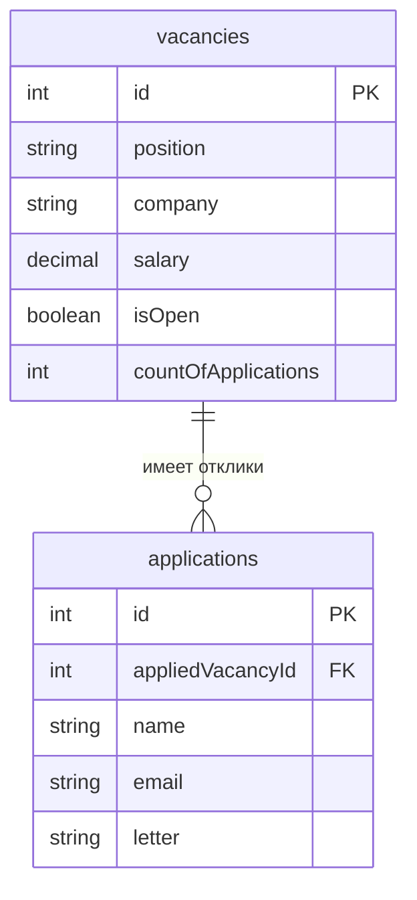

# Название проекта

Тема №7: Сайт вакансий. Одна фраза: вакансии от работодателей соискателям.

| | |
| --- | --- |
| Главная сущность | Vacancy |
| Связанная сущность (1:N) | Application |
| Фишка | Нельзя откликнуться на закрытую вакансию или повторно с тем же email |
| Стек | C#, ASP.NET Core (Minimal API) |

## Как запустить

```bash
git clone https://github.com/n1kil/backend-chernyavsky-vacancy-site
cd backend-vacancy-site

cd VacancySite

dotnet restore
dotnet build

dotnet run
```

Сервис работает на `http://localhost:8000`. Запросы для демонстрации лежат в `requests.http`.

## Эндпоинты

| Метод | Путь | Что делает | Ответ |
| --- | --- | --- | --- |
| GET | `/health` | Проверка, что сервис жив | 200 `{"status":"ok"}` |
| POST | `/api/vacancies` | Создать | 201 и объект с `id`; 400 при ошибке |
| GET | `/api/vacancies` | Список | 200 |
| GET | `/api/vacancies/{id}` | Получить одну запись | 200; 404 |
| PATCH | `/api/vacancies/{id}` | Изменить | 200; 400; 404 |
| DELETE | `/api/vacancies/{id}` | Удалить | 204; 404 |

## ER-диаграмма

<!-- С лабы 2. Блок mermaid GitHub рисует сам. -->



## Интерфейс

<!-- С лабы 4: скриншот, например  -->
